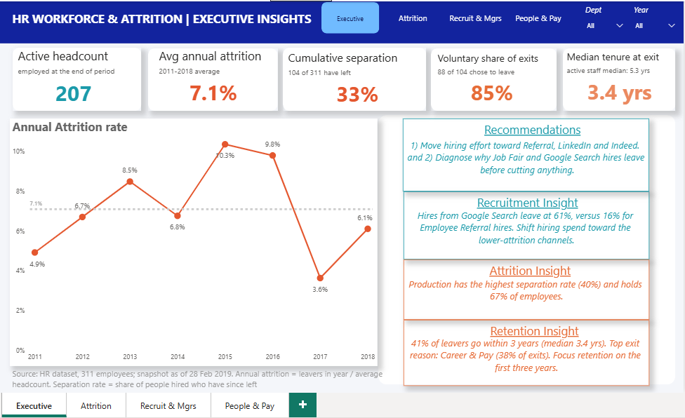
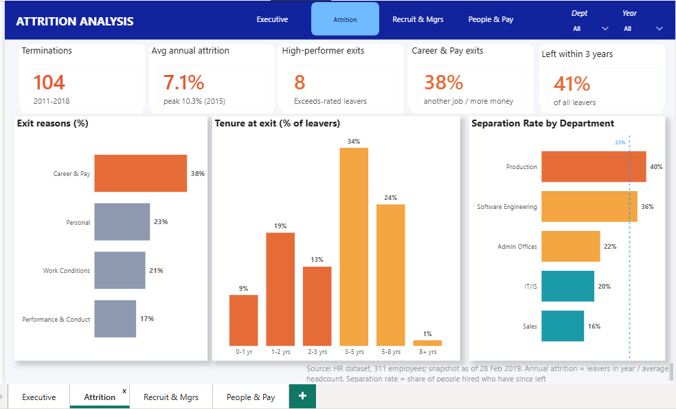
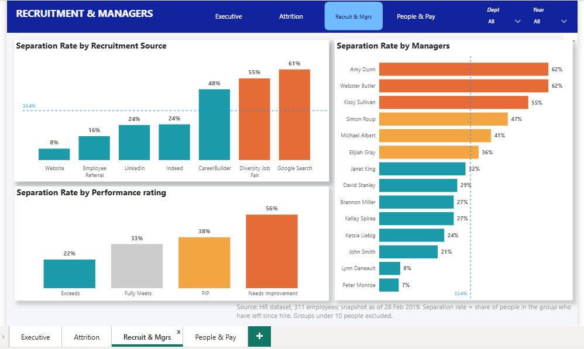
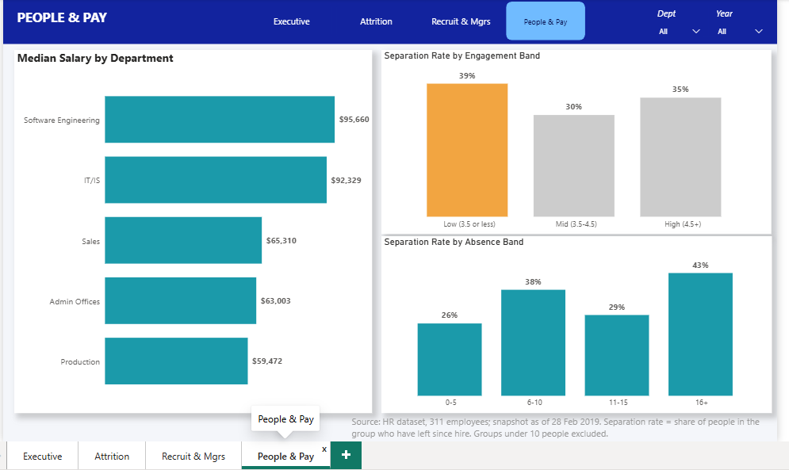

# HR Workforce & Attrition Analytics (Power BI)


**An end-to-end HR analytics project: raw employee records turned into a four-page Power BI dashboard that shows how fast a company loses people, when and why they leave, and where to act first.**



---

## Table of contents

1. [The 30-second summary](#the-30-second-summary)
2. [Business problem](#business-problem)
3. [Key findings](#key-findings)
4. [Recommendations](#recommendations)
5. [Dashboard walkthrough](#dashboard-walkthrough)
6. [Dataset](#dataset)
7. [Methodology](#methodology)
8. [Metric definitions](#metric-definitions)
9. [Validation](#validation)
10. [Limitations](#limitations)
11. [Repository structure](#repository-structure)
12. [How to use this project](#how-to-use-this-project)
13. [Next steps](#next-steps)
14. [Skills demonstrated](#skills-demonstrated)
15. [About me](#about-me)

---

## The 30-second summary

| | |
|---|---|
| **Question** | Does the company have a retention problem, and where should HR act first? |
| **Data** | 311 employee records (207 active, 104 left), hires from 2006 to 2018, snapshot as of 28 Feb 2019 |
| **Answer** | Yes, but it is concentrated. About **7% of people leave each year** (peaking above 10% in 2015 and 2016), **85% of exits are voluntary**, and most leavers go within five years, usually for **career or pay reasons**. Production holds two-thirds of staff, pays the least and loses four in ten of its people |
| **Biggest levers** | Three hiring channels supplied a third of staff but 55% of leavers; three Production teams lose more than half their people |
| **Tools** | Power Query, DAX, Power BI Desktop |

---

## Business problem

Leadership wants to know whether employee turnover is a problem and where to focus. The dashboard is built around six questions:

1. How fast are we losing people each year, and is it getting worse?
2. When do people leave (tenure at exit)?
3. Why do they leave?
4. Where is it worst (department, manager) and which hiring channels produce people who stay?
5. Are we losing the people we can least afford to lose?
6. Can the engagement survey or attendance data warn us in advance?

---

## Key findings

> Figures below are from the full dataset with no filters applied.

1. **Turnover is about 7% a year.** Annual attrition averaged **7.1%** (2011 to 2018), peaking at **10.3% in 2015** and **9.8% in 2016**, and falling to 3.6% in 2017. **33%** (104 of 311) is the *cumulative* share of everyone ever employed who has left since 2006.
2. **Exits are mostly voluntary.** 88 of 104 leavers (**85%**) chose to go.
3. **The first five years are the risk window.** Median tenure at exit is **3.4 years**; **41%** of leavers go within three years. Active staff have a median of 5.3 years.
4. **People leave for opportunity, not unhappiness.** Grouped exit reasons: Career & Pay **38%**, Personal 23%, Work Conditions 21%, Performance & Conduct 17%. Only 13% of leavers gave "unhappy" as the reason.
5. **Production is the pressure point.** It is **67%** of the workforce, has a **40%** separation rate (83 of the 104 leavers), and has the lowest median salary ($59,472 vs $92,329 in IT/IS). Sales has the lowest separation rate (16%).
6. **Hiring channel matters.** Employee Referral hires have a 16% separation rate and LinkedIn and Indeed 24%, against **Google Search 61%**, Diversity Job Fair 55% and CareerBuilder 48%. Those last three channels supplied 33% of staff but **55% of leavers**. Average performance ratings are about the same across channels, so the difference is *retention*, not quality of work.
7. **A few teams stand out.** Of the 14 teams with 10 or more people, three Production teams lose 55% to 62% of their people, against a company rate of 33%. Together they hold 21% of employees and 37% of exits.
8. **The engagement survey did not flag leavers.** Voluntary leavers scored 4.18 on average vs 4.12 for active staff, and "high engagement" staff still leave at 35%. Absence is a weak signal (43% separation at 16+ absences vs 26% at 0 to 5).
9. **We lose solid performers, not stars or strugglers.** 78% of leavers were rated "Fully Meets". Needs Improvement staff leave most (56%), "Exceeds" least (22%); 7 voluntary exits were top performers.

---

## Recommendations

| # | Recommendation | Evidence |
|---|---|---|
| 1 | Move hiring effort toward Referral, LinkedIn and Indeed; consider a referral bonus paid at six months | 16% / 24% vs 48% to 61% separation |
| 2 | Find out why Job Fair and Google Search hires leave **before** cutting spend (the Job Fair is also an inclusion channel) | 55% and 61% separation |
| 3 | Review the three highest-turnover Production teams: exit interviews, skip-level conversations, compare practices with lower-turnover teams | 21% of staff, 37% of exits |
| 4 | Build a Production career ladder and review Technician pay | Career & Pay = 38% of exits; lowest median pay |
| 5 | Run stay interviews at 12, 24 and 36 months | 41% of exits within three years |
| 6 | Redesign the engagement survey to include pay fairness and career growth | Current survey does not separate leavers from stayers |

---

## Dashboard walkthrough

The report has four pages with one consistent colour rule: **orange = problem, teal = healthy, grey = neutral**. Department and Year slicers are available on every page.

### 1. Executive Insights
Five KPIs (headcount, average annual attrition, cumulative separation, voluntary share, median tenure at exit), the annual attrition trend with its average line, and four insight cards written as DAX measures so the sentences update with the filters.


### 2. Attrition Analysis
When and why people leave: grouped exit reasons, tenure at exit, and separation rate by department.



### 3. Recruitment & Managers
Which hiring channels and teams retain people, and how separation varies with performance rating. Groups with fewer than 10 people are excluded.



### 4. People & Pay
Median salary by department, and whether engagement or absence relates to leaving.



---

## Dataset

- **Source:** *Human Resources Data Set* by Dr. Rich Huebner and Dr. Carla Patalano, published on [Kaggle](https://www.kaggle.com/datasets/rhuebner/human-resources-data-set). It is a fictional dataset created for teaching HR analytics.
- **Size:** 311 employees, one row per person (employment status, department, position, manager, recruitment source, hire and termination dates, termination reason, salary, performance score, engagement and satisfaction scores, absences).
- **Snapshot date:** the last termination is in November 2018 and the last performance review in February 2019, so I used **28 February 2019** as a fixed "as-of" date for age and tenure (not today's date, which would make every active employee about eight years older and the results change on each refresh).
- **Licence and attribution:** the dataset belongs to its authors; please see the Kaggle page for its licence terms. **This repository does not include the raw data file.** Download it from the link above (see [How to use this project](#how-to-use-this-project)).

---

## Methodology

### 1. Data preparation (Power Query)

| Issue found in the raw file | Why it matters | What I did |
|---|---|---|
| Trailing spaces in `Sex` ("M "), `Department`, `Position`, `Employee_Name` | Splits one category into two in slicers and breaks filters such as `Sex = "M"` | Trimmed text columns |
| Dates stored as US-format text (m/d/yyyy) | Day-first regional settings misread 7/5/2011 as 7 May | Converted using the English (United States) locale |
| Blank termination date for active staff | Date comparisons silently drop them | Added `EffectiveEndDate` (31 Dec 2099 for active staff) so "employed on date X" is one comparison |
| 17 free-text termination reasons | Too many categories to act on | Grouped into 4: Career & Pay, Work Conditions, Performance & Conduct, Personal |
| No tenure, age or band columns | Needed for tenure, age, engagement and absence analysis | Added `TenureYears`, `Age`, and ordered band columns |
| Redundant ID columns | Clutter | Removed |

### 2. Data model

A star-style model: one fact-style table (`HRDataset`), a generated `DimDate` calendar, and a separate `_measures` table.

`DimDate` has **two relationships** to the employee table: an active one on **hire date**, and an inactive one on **termination date** that measures switch on with `USERELATIONSHIP`. This is a role-playing date dimension, and it lets one calendar answer both "who was hired in 2015" and "who left in 2015".

### 3. Measures (DAX)

The headline measures, with the reasoning behind each:

```DAX
-- Headcount on the last day of the selected period
Headcount End =
VAR EndDate = MAX(DimDate[Date])
RETURN
CALCULATE(
    COUNTROWS(HRDataset),
    REMOVEFILTERS(DimDate),
    HRDataset[DateofHire] <= EndDate,
    HRDataset[EffectiveEndDate] > EndDate
)

-- People who left during the selected period (by termination date)
Terminations in Period =
CALCULATE(
    COUNTROWS(HRDataset),
    HRDataset[Termd] = 1,
    USERELATIONSHIP(DimDate[Date], HRDataset[DateofTermination])
)

-- Standard HR turnover rate: leavers / average headcount
Annual Attrition % =
DIVIDE([Terminations in Period], [Average Headcount])

-- Headline KPI: average of yearly rates, 2011 to 2018
Avg Annual Attrition % =
AVERAGEX(
    FILTER(VALUES(DimDate[Year]), DimDate[Year] >= 2011 && DimDate[Year] <= 2018),
    [Annual Attrition %]
)

-- Share of people in a group who have left since hire (used to compare groups)
Separation Rate = DIVIDE([Terminated], [Total Employees])
```

**Design decisions worth noting**

- **Average headcount in the denominator.** The company grew from 21 to 101 people during 2011, so neither the opening nor the closing headcount is a fair base. The average of the two is the standard convention.
- **2011 to 2018 only for the average.** Before 2011 the company had 13 to 21 people, so one resignation moves the rate by about five points; 2019 holds two months of data and no exits.
- **Small-sample rule.** Recruitment channel and manager charts only show groups with at least 10 people; the department chart excludes the one-person Executive Office.
- **Data-driven insight cards.** The text cards are DAX measures built with `ADDCOLUMNS`, `TOPN` and `FORMAT`, so a stakeholder who filters to one department gets a sentence about that department instead of stale typed text.

---

## Metric definitions

| Metric | Definition | Used for |
|---|---|---|
| **Annual attrition %** | Leavers in the year ÷ average headcount (opening + closing ÷ 2) | Trends over time |
| **Average annual attrition** | Mean of the yearly rates, 2011 to 2018 | Headline KPI and baseline |
| **Separation rate** | Share of people in a group who have left since hire (cumulative) | Comparing departments, channels, managers, ratings |
| **Cumulative separation** | 104 of 311 = 33.4% | Context only, not an annual rate |
| **Headcount (end of period)** | Hired on or before the last day and not yet terminated | Workforce size |
| **Voluntary share** | Voluntary terminations ÷ all terminations | Retention vs discipline |
| **Median tenure at exit** | Median years from hire to termination for leavers | Timing of exits |
| **Exit Category** | Raw reasons grouped into four categories (a judgement-based mapping) | Why people leave |

---

## Validation

Every headline figure can be reproduced from the raw file with an Excel PivotTable. For example, put `RecruitmentSource` in Rows, `Count of EmpID` and `Average of Termd` in Values (the average of a 0/1 flag is the separation rate).

| Check | Expected value |
|---|---|
| Total employees / terminated / active | 311 / 104 / 207 |
| Cumulative separation rate | 33.4% |
| Voluntary terminations | 88 (84.6%) |
| Annual attrition 2015 (23 leavers, average headcount 222.5) | 10.3% |
| Average annual attrition, 2011 to 2018 | 7.1% |
| Median tenure at exit | 3.4 years |
| Production: employees / leavers / separation rate | 209 / 83 / 39.7% |
| Google Search / Employee Referral separation rate | 61% / 16% |

---

## Limitations

I would rather state these than have a reader find them:

- **One fictional company and one snapshot.** The dataset is illustrative, ends in early 2019, and has no history of pay, promotions or headcount over time. Headcount in past years is reconstructed from hire and termination dates.
- **Cohort age affects channel comparisons.** People hired in 2011 have had up to seven years to leave, and 28 of the 49 Google Search hires were made in 2011. Using only the 128 people hired in 2011 and 2012 (equal exposure), the ranking holds but the gaps shrink: Google Search 72%, Diversity Job Fair 72%, CareerBuilder 67%, Indeed 50%, LinkedIn 46%. Referral (25%, 4 people) and Website (20%, 5 people) are too small to be conclusive.
- **Small groups.** Website (13 hires), Software Engineering (11 people) and Admin (9) are too small to rank with confidence.
- **Correlation, not causation.** Manager and channel results are patterns to investigate, not proof of cause. Team sizes are 17 to 22 people, so a handful of exits moves the rate a lot, and some teams differ in hiring channel or department.
- **Exit-reason grouping is a judgement call.** A different mapping would shift the category percentages slightly.
- **Weak early-warning signals.** Absence and lateness correlate only weakly with leaving (about 0.1 to 0.14). They are conversation triggers, not a prediction model.

---

## Repository structure

```
hr-workforce-attrition-powerbi/
├── README.md
├── dashboard/
│   ├── HR_Attrition_Dashboard.pbit     # Power BI template (model, measures, visuals; no data)
│   └── HR_Attrition_Dashboard.pdf      # exported report pages
├── data/
│   └── README.md                       # where to download the dataset (raw file not included)
├── docs/
│   ├── power-query-steps.md            # full M script and column logic
│   └── dax-measures.md                 # every measure with explanation
└── images/
    ├── 01-executive-insights.png
    ├── 02-attrition-analysis.png
    ├── 03-recruitment-and-managers.png
    └── 04-people-and-pay.png
```

---

## How to use this project

**Just want to see the results?** Open the PDF in `dashboard/` or scroll through the screenshots above.

**Want to explore it in Power BI?**

1. Download the dataset from [Kaggle](https://www.kaggle.com/datasets/rhuebner/human-resources-data-set) and save the HR file as `HRDataset_Raw.csv`.
2. Open `dashboard/HR_Attrition_Dashboard.pbit` in Power BI Desktop (free).
3. When prompted, enter the file path to your CSV, then click **Load**.

---

## Skills demonstrated

- **Data preparation:** Power Query, text and date cleaning, locale handling, custom columns, grouping, data-quality checks
- **Data modelling:** star schema, role-playing date dimension with active and inactive relationships, a dedicated measures table
- **DAX:** `CALCULATE`, `USERELATIONSHIP`, `REMOVEFILTERS`, `ALLSELECTED`, `VAR/RETURN`, iterators, `TOPN`, dynamic text measures
- **Analytics judgement:** annual vs cumulative rates, average-headcount denominators, small-sample rules, cohort-exposure checks
- **Dashboard design:** KPI hierarchy, consistent colour semantics, page navigation, descriptive titles and source footers
- **Communication:** findings tied to evidence, prioritised recommendations, explicit limitations

---

## About me

**Sherifat Adeshina**, Data Analyst

- LinkedIn: [https://www.linkedin.com/in/adeshina-sherifat]
- Medium write-up: [https://medium.com/@eyinadeadeshina36/list/from-data-to-decision-making-561ab26ca151]
- GitHub: [https://github.com/AdeeTheAnalyst]
- Email: [mailto:eyinadeadeshina36@gmail.com]

---

## Acknowledgements

Dataset: *Human Resources Data Set* by Dr. Rich Huebner and Dr. Carla Patalano (Kaggle).